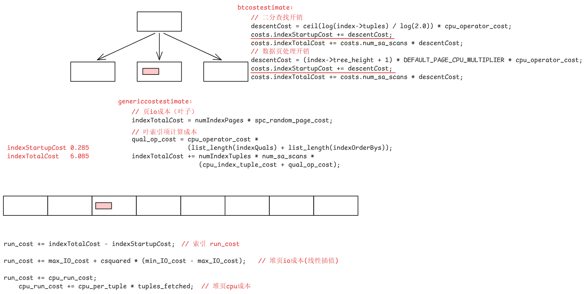

# Cost

参考文档: [https://www.interdb.jp/pg/pgsql03/02.html](https://www.interdb.jp/pg/pgsql03/02.html)

```sql
DROP TABLE IF EXISTS tbl;
CREATE TABLE tbl (id int PRIMARY KEY, data int);
CREATE INDEX tbl_data_idx ON tbl (data);
INSERT INTO tbl SELECT generate_series(1,10000),generate_series(1,10000);
ANALYZE tbl;
\d tbl
      Table "public.tbl"
 Column |  Type   | Modifiers
--------+---------+-----------
 id     | integer | not null
 data   | integer |
Indexes:
    "tbl_pkey" PRIMARY KEY, btree (id)
    "tbl_data_idx" btree (data)
```

```c
make_one_rel
	set_base_rel_pathlists
		set_rel_pathlist
			set_plain_rel_pathlist
				create_seqscan_path
				create_index_paths
					foreach(lc, rel->indexlist)
						get_index_paths
				create_tidscan_paths
```

## SeqScan

```sql
EXPLAIN SELECT * FROM tbl WHERE id <= 8000;
                       QUERY PLAN                       
--------------------------------------------------------
 Seq Scan on tbl  (cost=0.00..170.00 rows=8000 width=8)
   Filter: (id <= 8000)
```

```c
pg_plan_query | planner | standard_planner | subquery_planner
    grouping_planner | query_planner
        make_one_rel | set_base_rel_pathlists | set_rel_pathlist
	        set_plain_rel_pathlist
	            create_seqscan_path
	                Path *pathnode = makeNode(Path);
	                pathnode->pathtype = T_SeqScan;
	                cost_seqscan
		                path->total_cost = startup_cost + cpu_run_cost + disk_run_cost;
```

## IndexScan

```sql
EXPLAIN SELECT id, data FROM tbl WHERE data <= 240;
                                QUERY PLAN                                 
---------------------------------------------------------------------------
 Index Scan using tbl_data_idx on tbl  (cost=0.29..13.49 rows=240 width=8)
   Index Cond: (data <= 240)
```

```c
pg_plan_query | planner | standard_planner | subquery_planner
    grouping_planner | query_planner
        make_one_rel | set_base_rel_pathlists | set_rel_pathlist
	        set_plain_rel_pathlist
		        create_seqscan_path
		        create_index_paths /* Generate all interesting index paths for the given relation */
			        foreach(lc, rel->indexlist)
				        get_index_paths /* Build index paths from the restriction clauses */
					        build_index_paths /* Build simple index paths using the clauses */
						        create_index_path
							        cost_index
								        amcostestimate
								        clamp_row_est /* estimate number of main-table tuples fetched */
								        get_tablespace_page_costs
								        cost_qual_eval
```




## Sort

```sql
postgres=# EXPLAIN SELECT id, data FROM tbl WHERE data <= 240 ORDER BY id;
                                   QUERY PLAN                                    
---------------------------------------------------------------------------------
 Sort  (cost=22.97..23.57 rows=240 width=8)
   Sort Key: id
   ->  Index Scan using tbl_data_idx on tbl  (cost=0.29..13.49 rows=240 width=8)
         Index Cond: (data <= 240)
```

```c
grouping_planner
	query_planner
		make_one_rel
			set_base_rel_pathlists
				set_rel_pathlist
					set_plain_rel_pathlist
						create_seqscan_path
						create_index_paths
						create_tidscan_paths
					set_cheapest
						compare_path_costs(cheapest_startup_path, path, STARTUP_COST);
						compare_path_costs(cheapest_total_path, path, TOTAL_COST);
			make_rel_from_joinlist
	create_ordered_paths
		create_sort_path
			cost_sort(sort_mem=work_mem=4096K)
				cost_tuplesort
					1. external merge sort
					2. heap sort
					3. quick sort
						*startup_cost = comparison_cost * tuples * LOG2(tuples); /* 9.488 */
					*run_cost = cpu_operator_cost * tuples; /* 0.599 */
				startup_cost += input_cost; /* 9.488 + 13485 = 22.973 */
				path->total_cost = startup_cost + run_cost; /* 22.973 + 0.599 = 23.573 */
```

## QualCost

> src/include/nodes/pathnodes.h

```c
/*
 * The cost estimate produced by cost_qual_eval() includes both a one-time
 * (startup) cost, and a per-tuple cost.
 */
typedef struct QualCost
{
	Cost		startup;		/* one-time cost */
	Cost		per_tuple;		/* per-evaluation cost */
} QualCost;
```


```sql
postgres=# EXPLAIN SELECT data + 1 FROM tbl
WHERE id <= 8000 AND now() > '1990-01-01';
                                   QUERY PLAN                                    
---------------------------------------------------------------------------------
 Result  (cost=0.01..190.00 rows=8000 width=4)
   One-Time Filter: (now() > '1990-01-01 00:00:00+08'::timestamp with time zone)
   ->  Seq Scan on tbl  (cost=0.01..170.00 rows=8000 width=4)
         Filter: (id <= 8000)
```
